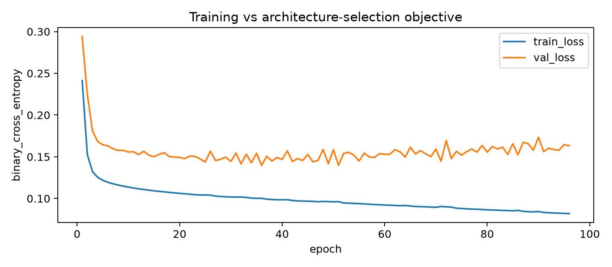
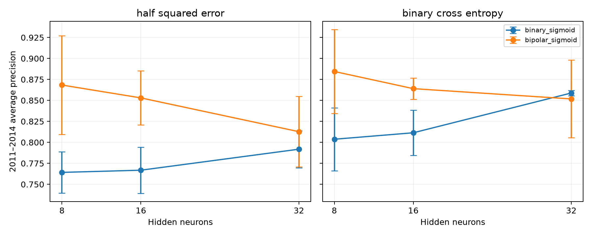
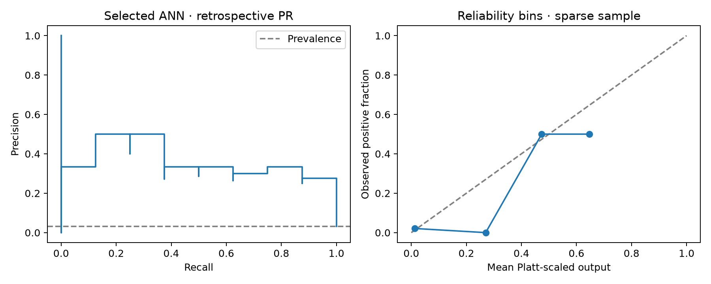

# Heatline: Nagpur May heatwave proxy prediction

## Problem and assessed contribution

Design and develop an ANN to predict May heatwave conditions in a specific geographical area: Nagpur, Maharashtra. The assessed contribution is a NumPy network with an explicit forward pass, activation derivatives, backpropagated errors, parameter gradients and momentum updates. The six-city weather dashboard is the product extension. Fuzzy inference, GA and the deeper PyTorch ensemble are optional theory extensions archived separately.

## Climate inputs and target

The existing cache contains April–May hourly Open-Meteo reanalysis for 1981–2026. Grid metadata declares ERA5 at 21.25°N, 79.0°E, elevation 311 m; the requested city coordinate is 21.1458°N, 79.0882°E. Original cached responses do not embed per-request model-selection provenance, so that declaration cannot be independently reconstructed from the files. Their SHA-256 hashes and the configuration are recorded in `artifacts/heatline/provenance.json`.

Hourly records are aggregated in Asia/Kolkata: temperature maximum/minimum/mean, humidity mean/minimum, dewpoint mean, apparent-temperature maximum, wind mean, pressure mean, integrated shortwave irradiance (Wh/m²/day), soil-moisture mean. Twenty-six features use observations through T−1: one-day lags, two/three-day temperature lags, three/seven-day rolling means, trends, pressure tendency, previous proxy streak, normal and calendar encoding. April initializes May history. Calendar gaps, duplicate dates, missing measurements and incomplete seven-day history fail explicitly. May features never use the outcome day's weather. A frozen 1981–2010 ±7-calendar-day reference supplies normals; available-data windows truncate at April/May boundaries.

The declared target **nagpur-grid-proxy-v1** is Tmax≥45°C OR (Tmax≥40°C and departure from the reference normal≥4.5°C), with departure rounded to the daily data's 0.01°C precision. It is an IMD-inspired single-grid daily proxy. Official declarations use station measurements with spatial/persistence requirements; this proxy does not reproduce them. No target was chosen to achieve a desired prevalence. The old adjusted 43.5°C / 3.5°C rule and 1991–2020 normals are preserved in `legacy/original-experiment.zip`.

| name | years | days | positives |
| --- | --- | --- | --- |
| train | 1981–2010 | 930 | 55 |
| selection | 2011–2014 | 124 | 15 |
| calibration | 2015–2018 | 124 | 8 |
| retrospective | 2019–2026 | 248 | 8 |

## Artificial neuron, learning rules and architecture

A neuron computes a weighted sum plus bias, then an activation. Binary sigmoid σ(a)=1/(1+exp(−a)); bipolar sigmoid f(a)=2σ(a)−1=tanh(a/2), with f′(a)=(1−f(a)²)/2. The output remains binary sigmoid for 0/1 heatwave targets. Identity, steps and ramp are illustrated in the appendix and guided notebook.

Hebbian updates associate inputs and targets. Perceptron learning adjusts a hard-threshold classifier on mistakes. Sigmoid delta learning uses the activation derivative to descend a continuous objective; it is distinct from linear LMS/ADALINE. XOR demonstrates that a single linear boundary is insufficient and that a hidden layer can solve the task. Whether a hidden layer helps weather data is an empirical question answered by comparisons below.

The selected network is **26 → 8 → 1**, hidden activation **bipolar_sigmoid**, objective **binary_cross_entropy**, seed 42. The textbook squared-error ANN remains a separately measured reference. The applied BCE variant is selected only using the earlier selection period; evaluation outcomes do not change the selection. η=0.05, μ=0.9, batch size 64; maximum 400 epochs, patience 60 using the same selection loss as the optimized objective. Weights use seeded Xavier initialization, biases start at zero. Standardization is fitted only on 930 training days.

## Backpropagation derivation

For batch X: Z=f(XV+v₀), a=ZW+w₀, ŷ=σ(a). With positive-class weight p, let q(t)=1+(p−1)t. Textbook L=mean[½q(t)(ŷ−t)²] has output-logit derivative d=q(t)(ŷ−t)ŷ(1−ŷ). Weighted BCE L=mean[−pt log ŷ−(1−t)log(1−ŷ)] has derivative d=q(t)ŷ−pt. The experiments set p=1; tests also check nonunit weights. Stable logaddexp computes BCE from logits.

Hidden derivative h=(dWᵀ)⊙f′(XV+v₀). Gradients are ∂L/∂W=Zᵀd/N, ∂L/∂w₀=mean(d), ∂L/∂V=Xᵀh/N, ∂L/∂v₀=mean(h). Compute all gradients with old weights before changing any parameter. Momentum update Δθ=−η∂L/∂θ+μΔθ_previous, then θ←θ+Δθ. Per-coordinate gradient clipping at 5 is an explicit optimizer safeguard, not a changed loss.

The supplied Experiment 7 α=0.25 denotes η, with μ=0. For the displayed illustrative 2–2–1 weights, input [0,1], target 1 gives output 0.581031948128, output update signal 0.101990994742, loss 0.087767114245→0.083346248108. Initial weights, hidden errors, connection and bias updates appear in the appendix. These weights were chosen as an inspectable fixture, not claimed as missing worksheet weights.

## Experiments and selection

The fixed architecture/objective grid compares 8,16,32 hidden neurons × binary/bipolar sigmoid × half-squared-error/BCE × seeds 7,21,42: 36 runs. Highest mean selection average precision chooses the configuration; ties use lower mean raw Brier and then fewer hidden neurons. The deployed seed is fixed at 42, not the best evaluation seed. Learning-factor studies compare η∈{0.01,0.05,0.1}, μ∈{0,0.9} across the same seeds on the chosen architecture. Their descriptive results do not retune the predeclared deployed η/μ. Duplicated configurations are reused; `runs.csv` contains 51 unique measured runs. Architecture curves show mean±sample standard deviation across three seeds; they are not independent-day confidence intervals.

Platt scaling (regularized logistic regression on clipped raw logits, C=1) is fitted only on 2015–2018. The threshold maximizes calibration-period F1; ties choose the higher threshold. The same policy applies to ANN, perceptron, sigmoid delta and logistic comparisons. Persistence uses the preceding day's proxy at threshold 0.5. Climatology is a training-only ±3 May-day empirical event rate and uses a calibration-selected threshold. A transformed sigmoid score is not guaranteed calibrated; raw and transformed Brier scores and reliability-bin counts are exported.

## Retrospective results

| model | pr_auc | precision | recall | f1 | brier | tn | fp | fn | tp |
| --- | --- | --- | --- | --- | --- | --- | --- | --- | --- |
| NumPy ANN | 0.3636 | 0.5000 | 0.2500 | 0.3333 | 0.0246 | 238 | 2 | 6 | 2 |
| ANN textbook squared error | 0.4375 | 0.5000 | 0.5000 | 0.5000 | 0.0251 | 236 | 4 | 4 | 4 |
| ANN cross-entropy | 0.3636 | 0.5000 | 0.2500 | 0.3333 | 0.0246 | 238 | 2 | 6 | 2 |
| Persistence | 0.1809 | 0.4286 | 0.3750 | 0.4000 | 0.0363 | 236 | 4 | 5 | 3 |
| Climatology | 0.1136 | 0.0673 | 0.8750 | 0.1250 | 0.0309 | 143 | 97 | 1 | 7 |
| Perceptron | 0.4446 | 0.5000 | 0.1250 | 0.2000 | 0.0278 | 239 | 1 | 7 | 1 |
| Sigmoid delta rule | 0.4886 | 0.5000 | 0.2500 | 0.3333 | 0.0221 | 238 | 2 | 6 | 2 |
| Logistic regression | 0.4991 | 0.5000 | 0.2500 | 0.3333 | 0.0223 | 238 | 2 | 6 | 2 |

PR-AUC is average precision, not trapezoidal integration. Brier is mean squared error of the score against the outcome; persistence uses hard 0/1 outputs. TN/FP/FN/TP give the full confusion matrix. Only **8 positives among 248 evaluation days** occur under the declared rule. The selected BCE ANN AP is 0.3636 and F1 0.3333; the textbook squared-error network F1 is 0.5000. Logistic regression AP is 0.4991. Simpler models can outperform this ANN. Selecting the squared-error model because of this table would reuse evaluation outcomes, so the published primary selection remains unchanged.

Missed selected-ANN proxy events: 2019-05-27, 2019-05-31, 2020-05-24, 2026-05-20, 2026-05-21, 2026-05-25. False alarms: 2019-05-29, 2020-05-26. Each replay record carries input cutoff, target date, split, raw score, transformed output, threshold, outcome and model version. Training-era displays are in-sample; selection/calibration displays participated in those fitting decisions.

## Application, reproducibility and limitations

The Next.js application offers landing, provider outlook, Nagpur May replay, neural-learning walkthrough and evidence views. FastAPI serves read-only versioned artifacts, and public Open-Meteo forecasts are cached separately for six cities. Provider initialization time is unavailable in the combined best_match response; snapshot issue time explicitly means retrieval time. The source, forecast/replay mode, freshness, target dates and unavailable regional ANN outputs remain visible. Stale caches preserve their original timestamps. The provider temperature screen and apparent temperature are distinct from the heatwave proxy.

The original 2019–2026 period was already examined in the legacy project, so these are retrospective results rather than a pristine untouched holdout. Adjacent weather days are correlated; rare events and a single grid limit statistical precision and geographical generalization. Reanalysis approximates conditions and arrives with delay, preventing direct live use. Compatible timely inputs, station validation, larger event samples and regional evaluation are required before any operational ANN claim. Platt scaling on 124 days may fail under distribution shift. A deeper ensemble does not automatically remedy calibration or data-source mismatch. No health/warning claim is made.

Reproduce: `python -m src.experiment`, `python scripts/export_evidence.py`, `python scripts/build_lab_notebook.py`, `python -m pytest -q`. The independent PyTorch graph validates the same architecture and gradients without supplying the NumPy training implementation. The legacy deeper model used a different target and cannot share the new comparison table.

## Sources

- [IMD heatwave criteria](https://mausam.imd.gov.in/pdfs/heatcolduser/morning_heat_bulletin.pdf)
- [Open-Meteo historical data and ERA5 availability](https://open-meteo.com/en/docs/historical-weather-api)
- [Open-Meteo weather-provider forecast documentation](https://open-meteo.com/en/docs)
- [Open-Meteo attribution, terms and rate limits](https://open-meteo.com/en/terms)
- [Render Free limitations](https://render.com/docs/free)
