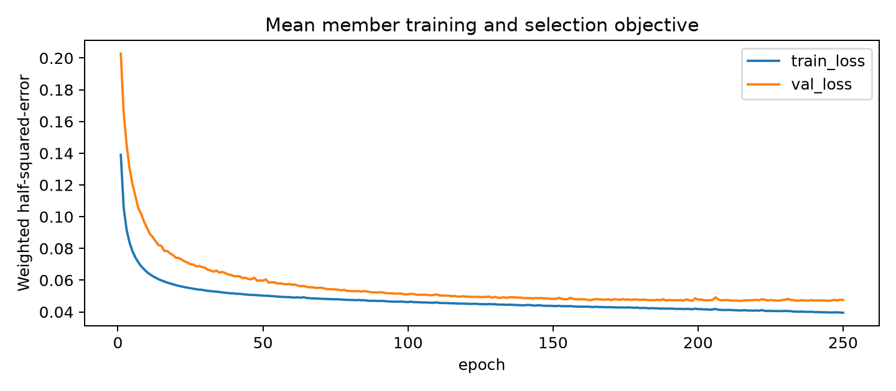
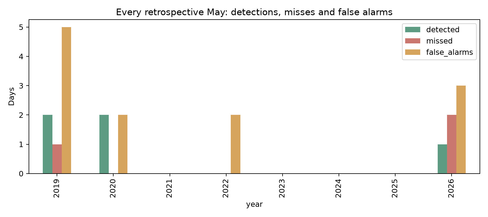
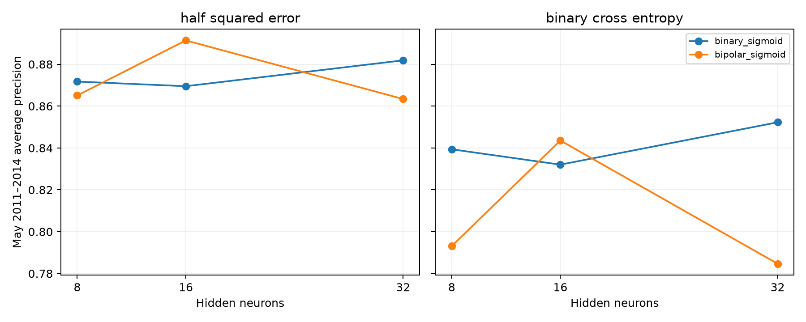
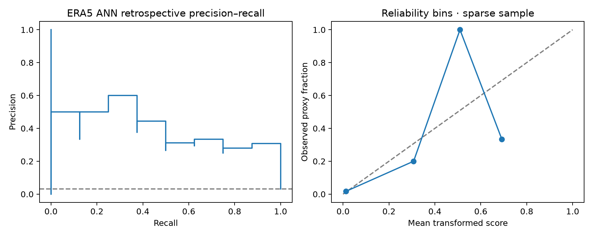

# Heatline: seasonal NumPy ANN for Nagpur May heatwave conditions

This report preserves the original 26-input v2 experiment. The separate full-history 52-input study, expanding-window evaluation and all-data refit are documented in [Evaluation protocol](EVALUATION.md). Their periods, reference normals and model versions differ; do not merge the scores.

## Problem and assessed contribution

The task is next-day binary prediction of May heatwave conditions for Nagpur, using earlier climate observations. The assessed implementation explicitly computes neuron activations, gradients, bias updates and momentum in NumPy. The selected architecture is **26 → 16 → 1**, with **bipolar_sigmoid** hidden units and a binary sigmoid output. Three independently initialized networks are averaged for the application; the single seed-42 network remains an independently reported baseline. Fuzzy/GA/deeper PyTorch models are legacy optional theory extensions. PyTorch checks derivatives but does not perform assessed training.

## Data audit and target

The requested coordinate is 21.1458°N, 79.0882°E; the ERA5 grid is 21.25°N, 79.0°E. The expanded cache covers March 25–June 30 in each of 1981–2026, with 98 contiguous local days per year. March primes preceding history, April–June supplies training examples, and **every reported assessed evaluation is May only**. Hourly aggregation uses Asia/Kolkata. Missing hourly values, duplicate dates, gaps and missing lag history are rejected.

Original April/May cache comparison: **2806 overlapping days, maximum daily Tmax difference 0.0°C, 0 May label changes**. May's 26 features also match v1 exactly. The proxy remains `nagpur-grid-proxy-v1`: Tmax≥45°C OR (Tmax≥40°C and frozen-reference departure≥4.5°C), departure rounded to 0.01°C. Frozen 1981–2010 April/May reference values are retained for comparability; March/June references use only the added training years. Labels approximate a grid day and are not official IMD station declarations or warning bulletins.

The source audit uses training-era NASA samples rather than choosing a provider for more positive labels:

| year | may_days | nasa_mean_tmax | era5_mean_tmax | mean_nasa_minus_era5 | nasa_days_ge45 | era5_days_ge45 |
| --- | --- | --- | --- | --- | --- | --- |
| 1991 | 31 | 46.1465 | 43.1387 | 3.0077 | 25 | 0 |
| 2000 | 31 | 41.7206 | 39.8387 | 1.8819 | 3 | 0 |
| 2010 | 31 | 44.6697 | 43.4355 | 1.2342 | 19 | 6 |

UTC daily boundaries differ from ERA5 Asia/Kolkata. Provider comparison is descriptive and not a matched station validation. A limited NOAA airport-station cross-check is also descriptive:

| year | paired_days | mean_station_tmax | mean_era5_tmax | mean_era5_minus_station | mean_absolute_difference | station_days_ge45 | era5_days_ge45 |
| --- | --- | --- | --- | --- | --- | --- | --- |
| 1991 | 30 | 43.6259 | 43.1100 | -0.5159 | 0.7819 | 5 | 0 |
| 2000 | 31 | 40.4624 | 39.8387 | -0.6237 | 0.9814 | 3 | 0 |
| 2010 | 31 | 44.5197 | 43.4355 | -1.0842 | 1.0986 | 17 | 6 |

NOAA GSOD maximum temperatures summarize synoptic reports; reporting windows can overlap the previous day and differ from local calendar days. Training-era descriptive audit only; not an official warning-label validation. These comparisons establish source sensitivity, not which proxy is the official truth. Raw responses, request metadata and hashes are retained. ERA5 remains the assessed before/after target; NASA is reported separately.

## Climate inputs and chronology

The 26 inputs retain lagged temperature, humidity, dewpoint, apparent temperature, wind, pressure, integrated irradiance, soil moisture, rolling means, tendencies, preceding proxy streak, reference normal and calendar harmonics. Every prediction for T uses observed weather through T−1. Calendar/reference features for T are deterministic. June of the same year never enters the inputs of a preceding May day. Normalization fits only April–June 1981–2010, independently of validation or evaluation years.

| name | years | days | positives |
| --- | --- | --- | --- |
| train · April–June | 1981–2010 | 2730 | 117 |
| selection · May | 2011–2014 | 124 | 15 |
| calibration · May | 2015–2018 | 124 | 8 |
| retrospective · May | 2019–2026 | 248 | 8 |

Training expands from 930 May days /55 positives to **2730 seasonal days /117 positives**. The positive fraction is still small. Positive weight is fitted from training class counts only; the selected weight is 22.3333.

## Neuron, activation and learning rule

For X, hidden Z=f(XV+v₀), output logit s=ZW+w₀, and ŷ=σ(s). Binary sigmoid is σ(a)=1/(1+exp(−a)); bipolar sigmoid is tanh(a/2), derivative (1−f(a)²)/2. Hidden bipolar activation does not change the binary output target convention.

For positive weight p, q(t)=1+(p−1)t. The textbook objective L=mean[½q(t)(ŷ−t)²] gives output-logit derivative d=q(t)(ŷ−t)ŷ(1−ŷ). Weighted BCE L=mean[−pt log ŷ−(1−t)log(1−ŷ)] gives d=q(t)ŷ−pt. Both objectives and their exact derivatives are compared; the selected revised model uses the textbook weighted squared-error objective.

Hidden derivative h=(dWᵀ)⊙f′(XV+v₀). Gradients: Zᵀd/N, mean(d), Xᵀh/N, mean(h) for W,w₀,V,v₀ respectively. All gradients use old parameters. Δθ=−η∇L+μΔθ_previous, θ←θ+Δθ. The selected experiment uses η=.03, μ=.9, batch 128, up to 300 epochs, patience 35. Early stopping evaluates the declared weighted objective on May 2011–2014. Weights use seeded Xavier initialization; biases start at zero; gradients are clipped per coordinate at 5.

Experiment 7 uses an independent scalar fixture: x=[0,1], target 1, η=α=.25, μ=0, explicitly displayed illustrative initial weights. Output 0.581031948128, output error signal 0.101990994742; a full connection/bias update reduces loss 0.087767114245→0.083346248108. Binary/bipolar delta examples, fixed-threshold NAND/NOR/memory, Hebbian association, perceptron AND and trained XOR remain in the executed notebook.

| experiment | title | co | connection |
| --- | --- | --- | --- |
| 1 | Activation functions | CO1 | Identity, binary/bipolar step and sigmoid, ramp; compare sigmoid hidden activations. |
| 2 | McCulloch–Pitts neuron | CO1 | Fixed-threshold NAND, NOR and recurrent memory; no learning. |
| 3 | Hebbian learning | CO3 | Binary/bipolar association through weight updates. |
| 4 | Perceptron learning | CO2 | AND is separable; XOR is not. A single-layer weather comparator. |
| 5 | Delta learning | CO2 | Error-driven sigmoid updates; distinguish from linear LMS/ADALINE. |
| 6 | Multilayer perceptron | CO2 | A hidden layer learns XOR; the heatwave model uses the same architecture principle. |
| 7 | Error backpropagation | CO2 | Numerical 2–2–1 trace; α=0.25 denotes η; μ=0. |

## Selection, repeated seeds and operating decisions

The versioned `config_v2.yaml` fixes the experiment before its retrospective evaluation: 8/16/32 hidden neurons × binary/bipolar sigmoid × half-squared-error/BCE × no/square-root-ratio/full-ratio weighting, each with seeds 7/21/42. The 36 configurations use 108 trained members. Highest **May 2011–2014 average precision of the three-member mean** chooses the primary configuration; ties use lower selection Brier then smaller hidden width. Training-window and learning-factor ablations are descriptive and do not replace this choice based on later scores. All runs are exported with their selection-period results.

Inference averages each member's sigmoid score, not logits or weights. Platt scaling fits only May 2015–2018. The sensitivity threshold maximizes F2 (recall weighted more heavily), with ties preferring precision then higher threshold. The balanced threshold independently maximizes F1 on the same calibration period. Calibration scores are fitted, not independent performance evidence. An ensemble or Platt scaling does not guarantee calibration.

## Retrospective results on unchanged ERA5 May targets

Metric interpretation: the primary ANN's 29.4% is alert precision (5 correct alerts out of 17), not accuracy. Accuracy is 233/248 = 94.0%; always-negative predictions score 240/248 = 96.8% but miss all eight positive days. Balanced accuracy is 78.8%. False alarms remain a real limitation; confusion counts, precision, recall, F1 and average precision are the main evidence.

Primary sensitivity policy:

| model | pr_auc | precision | recall | f1 | f2 | brier | tn | fp | fn | tp |
| --- | --- | --- | --- | --- | --- | --- | --- | --- | --- | --- |
| NumPy ANN | 0.4097 | 0.2941 | 0.6250 | 0.4000 | 0.5102 | 0.0244 | 228 | 12 | 3 | 5 |
| Single NumPy ANN (seed 42) | 0.4068 | 0.2941 | 0.6250 | 0.4000 | 0.5102 | 0.0240 | 228 | 12 | 3 | 5 |
| ANN textbook squared error | 0.4097 | 0.2941 | 0.6250 | 0.4000 | 0.5102 | 0.0244 | 228 | 12 | 3 | 5 |
| ANN cross-entropy | 0.3515 | 0.3636 | 0.5000 | 0.4211 | 0.4651 | 0.0254 | 233 | 7 | 4 | 4 |
| Persistence | 0.1809 | 0.4286 | 0.3750 | 0.4000 | 0.3846 | 0.0363 | 236 | 4 | 5 | 3 |
| Climatology | 0.1136 | 0.0547 | 0.8750 | 0.1029 | 0.2188 | 0.0309 | 119 | 121 | 1 | 7 |
| Perceptron | 0.1994 | 0.1270 | 1.0000 | 0.2254 | 0.4211 | 0.0306 | 185 | 55 | 0 | 8 |
| Sigmoid delta rule | 0.3581 | 0.4000 | 0.5000 | 0.4444 | 0.4762 | 0.0260 | 234 | 6 | 4 | 4 |
| Logistic regression | 0.4627 | 0.2857 | 0.5000 | 0.3636 | 0.4348 | 0.0236 | 230 | 10 | 4 | 4 |
| Temperature trend | 0.3749 | 0.4286 | 0.3750 | 0.4000 | 0.3846 | 0.0249 | 236 | 4 | 5 | 3 |

Balanced policy:

| model | pr_auc | precision | recall | f1 | f2 | brier | tn | fp | fn | tp |
| --- | --- | --- | --- | --- | --- | --- | --- | --- | --- | --- |
| NumPy ANN | 0.4097 | 0.5000 | 0.2500 | 0.3333 | 0.2778 | 0.0244 | 238 | 2 | 6 | 2 |
| Single NumPy ANN (seed 42) | 0.4068 | 0.6000 | 0.3750 | 0.4615 | 0.4054 | 0.0240 | 238 | 2 | 5 | 3 |
| ANN textbook squared error | 0.4097 | 0.5000 | 0.2500 | 0.3333 | 0.2778 | 0.0244 | 238 | 2 | 6 | 2 |
| ANN cross-entropy | 0.3515 | 0.3636 | 0.5000 | 0.4211 | 0.4651 | 0.0254 | 233 | 7 | 4 | 4 |
| Persistence | 0.1809 | 0.4286 | 0.3750 | 0.4000 | 0.3846 | 0.0363 | 236 | 4 | 5 | 3 |
| Climatology | 0.1136 | 0.0673 | 0.8750 | 0.1250 | 0.2574 | 0.0309 | 143 | 97 | 1 | 7 |
| Perceptron | 0.1994 | 0.2222 | 0.2500 | 0.2353 | 0.2439 | 0.0306 | 233 | 7 | 6 | 2 |
| Sigmoid delta rule | 0.3581 | 0.4000 | 0.5000 | 0.4444 | 0.4762 | 0.0260 | 234 | 6 | 4 | 4 |
| Logistic regression | 0.4627 | 0.2857 | 0.5000 | 0.3636 | 0.4348 | 0.0236 | 230 | 10 | 4 | 4 |
| Temperature trend | 0.3749 | 0.5000 | 0.3750 | 0.4286 | 0.3947 | 0.0249 | 237 | 3 | 5 | 3 |

Against v1, detection increases from 2/8 to 5/8 and recall from 25.0% to 62.5%; false alarms increase from 2 to 12. Average precision changes from 0.3636 to 0.4097. This is a sensitivity trade-off, not a claim of universal superiority. Simpler baselines still win some metrics. F2 is 0.5102 for the selected ANN under the calibration-chosen policy.

| year | days | positive_days | detected | missed | false_alarms |
| --- | --- | --- | --- | --- | --- |
| 2019 | 31 | 3 | 2 | 1 | 5 |
| 2020 | 31 | 2 | 2 | 0 | 2 |
| 2021 | 31 | 0 | 0 | 0 | 0 |
| 2022 | 31 | 0 | 0 | 0 | 2 |
| 2023 | 31 | 0 | 0 | 0 | 0 |
| 2024 | 31 | 0 | 0 | 0 | 0 |
| 2025 | 31 | 0 | 0 | 0 | 0 |
| 2026 | 31 | 3 | 1 | 2 | 3 |

Onset analysis: 2 detected of 5 positive days that follow a negative day. Continuing hot spells are easier than onset; the application exposes both errors. Detected dates: 2019-05-27, 2019-05-28, 2020-05-24, 2020-05-25, 2026-05-21. Missed dates: 2019-05-31, 2026-05-20, 2026-05-25.

Uncertainty uses 1000 whole-May-year resamples, preserving within-month dependence. Intervals: average precision [0.3776322751322751, 0.5277777777777778], recall [0.3333333333333333, 1.0], F2 [0.2777777777777778, 0.7894736842105263]. Eight May years and few positive events; intervals do not include model-selection uncertainty.

## Independent NASA POWER benchmark

The secondary benchmark uses NASA POWER UTC daily meteorology, a separate training-only reference and the same year partitions. It has 613 positive training days and **45 positive evaluation days out of 248**, compared with eight ERA5 positives. Different event populations and reporting windows prevent interpreting its larger scores as an improvement on the ERA5 target.

The architecture, objective and weight mode are fixed from the ERA5 selection, with no NASA test-based architecture search. Fifty-two inputs contain seven lags of six meteorological variables, seven lagged temperature departures, previous-day proxy and calendar encoding. Early solar responses are missing, so radiation is excluded from all benchmark years rather than imputed or inconsistently included. NASA's 2m wind and UTC day are not ERA5's 10m wind and local day. A 16-neuron, one-hidden-layer NumPy network is trained for each of three seeds.

F2 operating point:

| model | pr_auc | precision | recall | f1 | f2 | brier | tn | fp | fn | tp |
| --- | --- | --- | --- | --- | --- | --- | --- | --- | --- | --- |
| NASA NumPy ANN | 0.8580 | 0.3729 | 0.9778 | 0.5399 | 0.7383 | 0.0689 | 129 | 74 | 1 | 44 |
| NASA logistic regression | 0.8731 | 0.3750 | 1.0000 | 0.5455 | 0.7500 | 0.0689 | 128 | 75 | 0 | 45 |
| Persistence | 0.7083 | 0.8222 | 0.8222 | 0.8222 | 0.8222 | 0.0645 | 195 | 8 | 8 | 37 |

F1 operating point (threshold also chosen only on calibration years):

| model | pr_auc | precision | recall | f1 | f2 | brier | tn | fp | fn | tp |
| --- | --- | --- | --- | --- | --- | --- | --- | --- | --- | --- |
| NASA NumPy ANN | 0.8580 | 0.5857 | 0.9111 | 0.7130 | 0.8200 | 0.0689 | 174 | 29 | 4 | 41 |
| NASA logistic regression | 0.8731 | 0.5395 | 0.9111 | 0.6777 | 0.8008 | 0.0689 | 168 | 35 | 4 | 41 |
| Persistence | 0.7083 | 0.8222 | 0.8222 | 0.8222 | 0.8222 | 0.0645 | 195 | 8 | 8 | 37 |

Persistence remains a strong classification baseline. The ANN provides better ranking than persistence here, but does not surpass it on F1. `provider_benchmark.json` contains every retrospective record; `nasa_seed*.npz` and `nasa_scaler.json` preserve the network and preprocessing.

## Reproducibility, application and limitations

Run `python -m src.seasonal_experiment`, `python -m src.provider_benchmark`, `python scripts/export_seasonal_evidence.py`, and `python scripts/build_lab_notebook.py`. Raw files are cached; training makes no provider calls. To acquire missing seasons, use `python -m src.seasonal_data` and its `--provider nasa` option. Cached study checkpoints are local, ignored intermediates; saved final member weights and normalization are versioned. The original v1 is frozen in `legacy/heatline-v1-experiment.zip`.

The 2019–2026 outcomes were inspected before this revision. Consequently all apparent gains are **exploratory retrospective findings**, not proof on an untouched holdout. A later untouched May or a predeclared prospective protocol is required for a new confirmation claim. Rare events, grid/station mismatch and daily-boundary differences limit generalization. The station audit is not an official-warning reconstruction. Higher recall can mean more false alarms; the complete trade-off is visible.

The dashboard presents historical daily inputs, each member's hidden/output computation and mean score. Delayed ERA5 cannot directly serve a validated live ANN; regional live ANN outputs remain unavailable. Current six-city weather is a separately labeled provider product with cached freshness. No official warning or health-decision claim is made.

## Sources

- [Open-Meteo archive and ERA5](https://open-meteo.com/en/docs/historical-weather-api)
- [NASA POWER daily API and time standards](https://power.larc.nasa.gov/docs/services/api/temporal/daily/)
- [NASA meteorological source methodology](https://power.larc.nasa.gov/docs/methodology/data/sources_meteorology/)
- [NOAA daily synoptic summary](https://www.ncei.noaa.gov/access/search/datasets/global-summary-of-the-day/)
- [IMD criteria](https://mausam.imd.gov.in/pdfs/heatcolduser/Definition.pdf)
